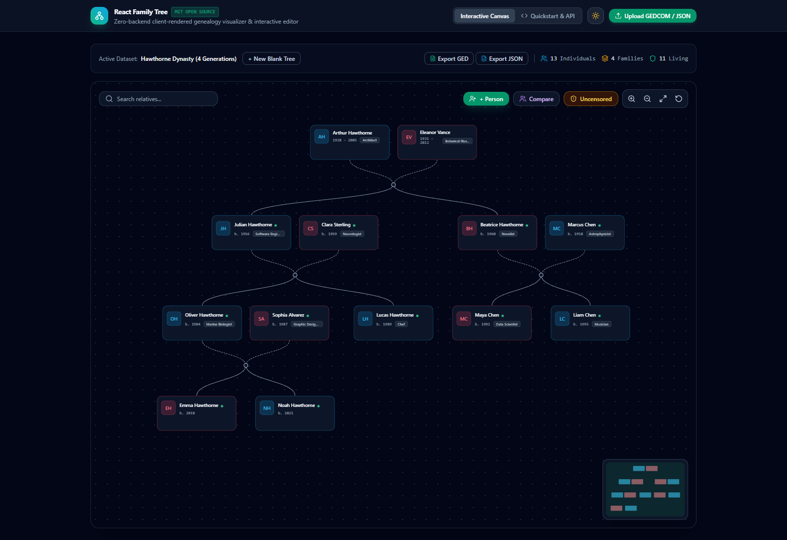
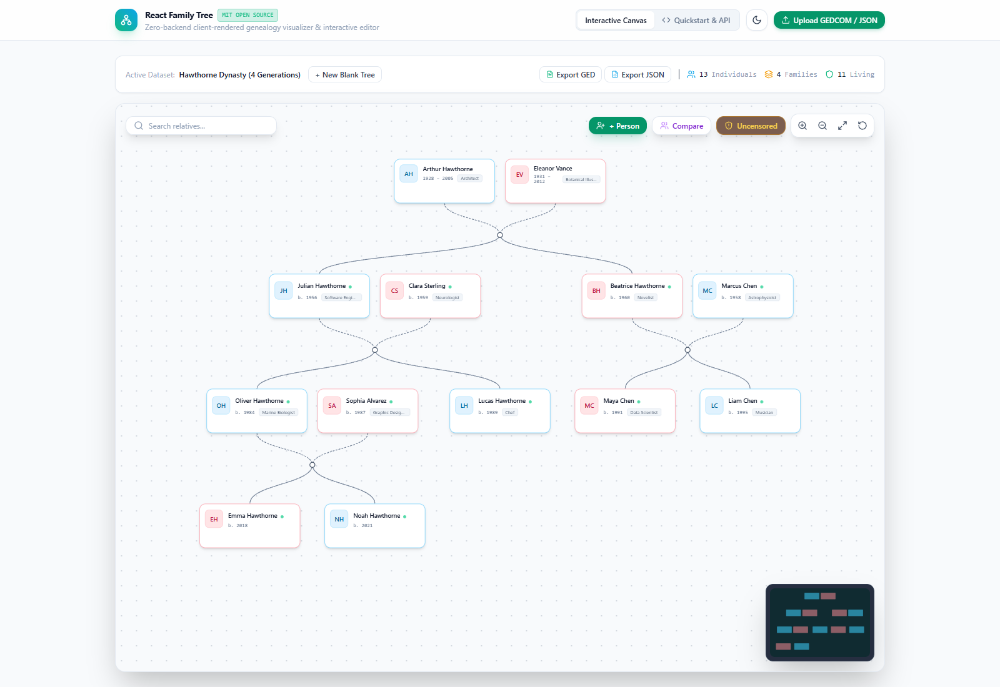
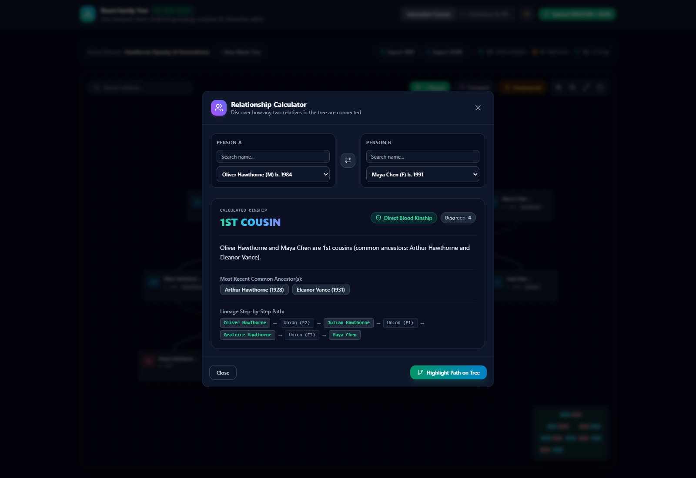
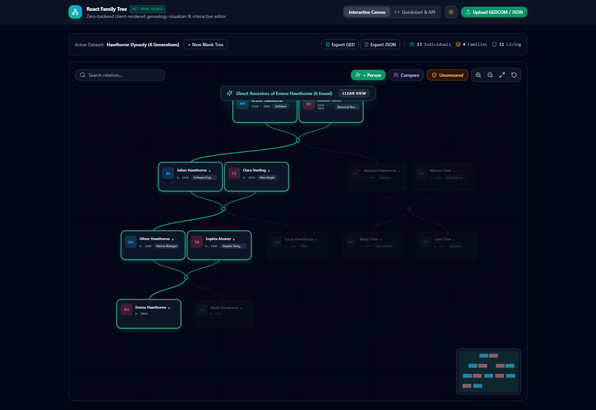
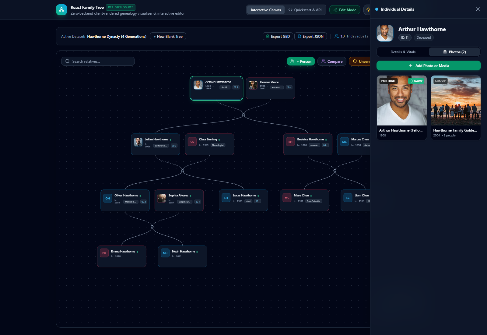
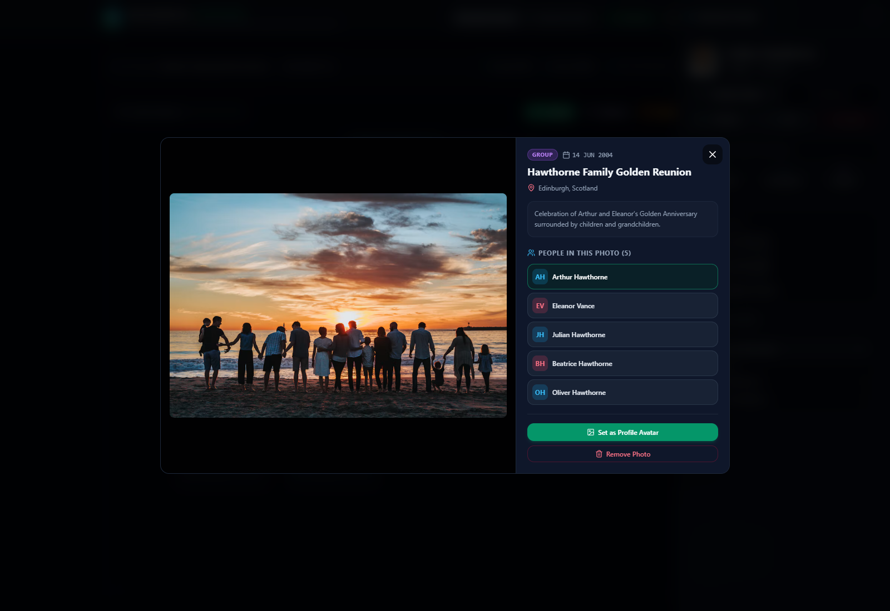
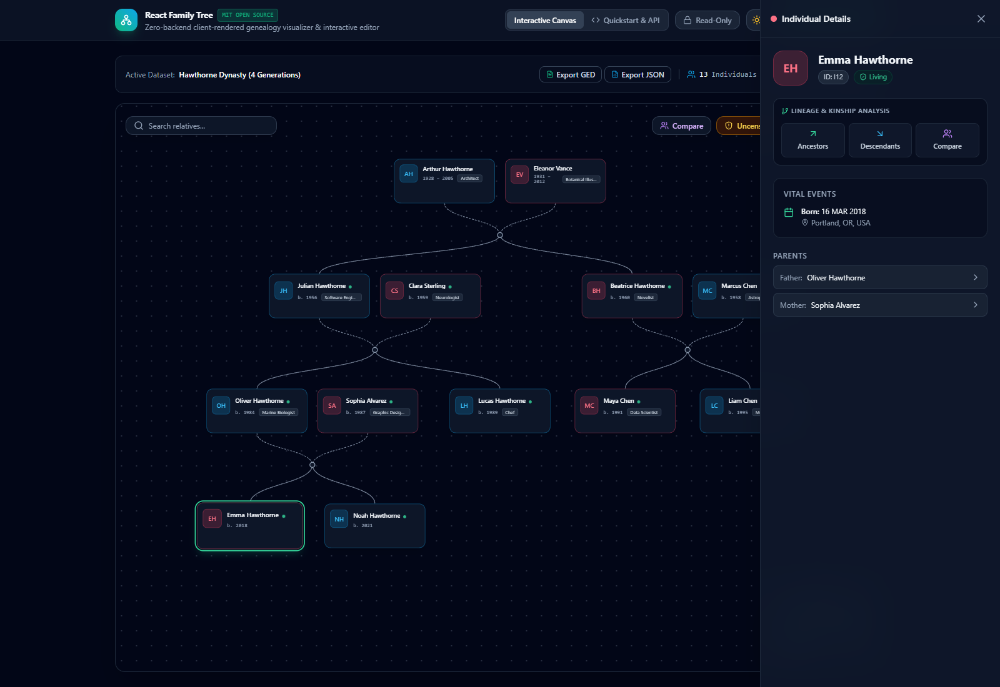

# @fahim-a/react-family-tree

A zero-backend, client-rendered interactive family tree visualizer and genealogy editor for React, featuring GEDCOM (5.5.x & 7.0) and JSON support, kinship analysis, lineage highlighting, photo albums, and time-travel history reverts.

[](LICENSE)
[](https://gedcom.io)
[](src/__tests__)
[](package.json)
[](tsconfig.json)

---

## Visual Preview

### Dark Mode & Light Mode Parity
Responsive, hardware-accelerated interactive canvas featuring cubic bezier relationship curves, centered marriage gates, and instant theme switching:





---

## Key Use Cases & Capabilities

### 1. Zero-Backend Ingestion & Dual Format Support
* **Explicit GEDCOM Standards Support (5.5.x & 7.0):**
  * **GEDCOM 5.5.x (5.5 & 5.5.1):** Full native compatibility with GEDCOM 5.5 and 5.5.1 specifications—the universal industry standard used across Ancestry, FamilySearch, MyHeritage, Gramps, and RootsMagic.
  * **Modern GEDCOM 7.0 — [FamilySearch GEDCOM 7.0](https://gedcom.io/specifications/FamilySearchGEDCOMv7.html) ([GitHub](https://github.com/FamilySearch/GEDCOM)):** Full compatibility with modern 7.0 structures maintained at [gedcom.io](https://gedcom.io/), featuring enforced UTF-8 character encoding, standardized extensions, and modern event tagging.
  * **Parser Ingestion:** Client-side parsing resolves standard lineage-linked tags across all 5.5.x and 7.0 files (including `INDI`, `FAM`, `HUSB`, `WIFE`, `CHIL`, `BIRT`, `DEAT`, `MARR`, `OCCU`, `NOTE`, `PLAC`, and custom `EVEN`/`TYPE` attributes).
  * **Exporter Compatibility:** Exports standard-compliant GEDCOM 5.5.1 (`.ged`) for universal roundtrip import into any third-party genealogy software, plus structured JSON (`.json`).
* **Normalized JSON Schema (`TreeData`):** Native bidirectional ingestion and export of clean JSON objects containing `people`, `families`, and `media`.
* **Historical Date Span:** Comprehensive date parsing supporting historical dates across centuries (1500s to present).

### 2. Interactive In-Browser Tree Editing (CRUD)
* **Build from Scratch:** Start with an empty tree and construct multi-generation lineages without any database or backend.
* **Add Independent / Root Person:** Add disconnected ancestors or new family branch patriarchs/matriarchs.
* **Multiple Non-Concurrent Spouses:** Connect individuals with multiple marriages across different time periods, maintaining distinct biological family units.
* **Children & Parents:** Automatically generates parent union gates and links children with generational positioning.
* **Link Existing Relatives:** Connect people already on the tree with cycle prevention to avoid generational loops.
* **Arbitrary Custom Key/Value Information:** Store custom attributes (e.g. `Burial Place`, `Military Rank`, `Immigration Ship`, `DNA Haplogroup`).
* **Cascade Deletion Safeguards:** Modal confirmation alerts users when removing an individual affects dependent subtrees.

### 3. Session History, Undo-Redo & Non-Destructive Timeline Revert
* **Audit Log & History Stack:** Every mutation records an immutable state snapshot with timestamps, action category badges, and affected relative names.
* **Undo / Redo Controls:** Quick toolbar buttons and global keyboard shortcuts (`Ctrl+Z` / `Cmd+Z` for Undo, `Ctrl+Y` / `Cmd+Shift+Z` for Redo).
* **Non-Destructive Append-Only Revert:** Interactive **History** timeline dialog allows clicking "Revert to this" on any historical step. Rather than truncating or discarding subsequent edits, the visualizer appends a new snapshot restore entry (`changeType: 'revert'`), preserving all previous changes in the session log. The revert itself can be undone via `Ctrl+Z`, guaranteeing no research work is ever lost.
* **Automatic History Reset:** Uploading a new GEDCOM, JSON file, or creating a blank tree automatically resets the history view to a fresh baseline.

### 4. Kinship & Natural Language Relationship Analysis
* Select any two individuals on the tree to compute their relationship:
  * **MRCA Detection:** Automatically locates the Most Recent Common Ancestor(s).
  * **Degrees of Kinship:** Calculates civil law degrees of kinship distance.
  * **Plain-English Classification:** Identifies First Cousins, Second Cousins, $N$ times removed, Aunts/Uncles, Grandparents, In-Laws, and Half-Siblings.
  * **Genetic Blood vs Marriage Distinction:** Accurately labels blood relations (`isDirectBlood: true`) versus marital connections.
  * **Shortest Path & Tracing:** Finds the shortest step-by-step path breadcrumb and highlights it on the canvas.



### 5. Lineage Highlighting
* **Direct Ancestors:** Highlights all direct biological parents, grandparents, and upstream ancestors with glowing emerald connector curves while dimming unrelated individuals.
* **Direct Descendants:** Traces all downstream children, grandchildren, and offspring with vibrant sky-blue connectors.
* **Kinship Connection Path:** Traces connection routes between selected relatives in amber.
* **Floating Status Banner:** Dismissible top banner indicating the active highlight query.



### 6. Photo Album, Tagging & Full-Screen Lightbox
* **Multi-Person Tagging:** Tag multiple relatives in a single group photograph or candid family snapshot.
* **Individual Avatars:** Assign any tagged photo as an individual's primary profile picture.
* **Slide-over Drawer Gallery:** Browse all photographs an individual appears in directly within their personal detail drawer.
* **Full-Screen Responsive Lightbox:** Inspect high-resolution photographs with date, location, historical notes, and clickable tagged relatives.
* **In-Canvas Camera Badges:** Person cards display visual camera badges indicating total associated photographs (`📷 N`).





### 7. Static Read-Only Viewing Mode
* Embedded deployments can set `editable={false}` to disable all mutation tools.
* Strips all edit buttons, drawer actions, and blank tree actions while preserving pan/zoom, search, lineage highlighting, and kinship calculations.



### 8. Living Relative Privacy Protection
* Configurable privacy filter to safeguard living relatives for public websites.
* Automatically masks names to `Private [Living]`, redacts exact birth dates and locations, and hides personal notes based on death records and configurable birth year cutoffs.

### 9. Dual Export Pipelines
* **Download as GEDCOM (`.ged`):** Generates specification-compliant GEDCOM 5.5.1 files with full custom event preservation.
* **Download as JSON (`.json`):** Formatted export of the normalized `TreeData` schema.

### 10. Responsive Architecture & Mobile/Desktop Adaptations
Tested and optimized across modern screen resolutions from mobile phones to 4K displays:
* **Mobile Phones (360×640, 390×844, 412×915):**
  * **Touch Gestures:** Native 1-finger drag panning and 2-finger Euclidean distance pinch-to-zoom (`touch-none` prevents viewport rubber-banding).
  * **Full-Width Drawer:** Detail drawer transitions from a side panel into a full-width card view (`w-full`), making attributes, family links, and photo galleries easy to browse on handheld devices.
  * **Intelligent Toolbar Collapsing:** Text labels collapse into compact touch icons (`hidden sm:inline`) and search bar collapses (`w-20 sm:w-40`) to preserve canvas real estate.
  * **MiniMap Auto-Hide:** MiniMap cleanly unmounts/hides on screens narrower than 640px (`hidden sm:block`) to prevent crowding the canvas.
* **Tablets (768×1024 iPad, 820×1180):**
  * Coexisting touch and pointer events; slide-over drawer occupies a comfortable 384px (`sm:w-96`) width.
  * MiniMap and relationship modals adapt with responsive grid layouts (`grid-cols-1 sm:grid-cols-2`).
* **Desktop & Laptops (1366×768, 1920×1080 FHD, 2560×1440 QHD):**
  * High-precision mouse wheel zooming centered around the cursor position.
  * Left-click drag panning with interactive grab/grabbing cursor states.
  * Full keyboard shortcuts (`Ctrl+Z` / `Cmd+Z` for Undo, `Ctrl+Y` / `Cmd+Shift+Z` for Redo).
* **4K UHD & Ultrawide (3840×2160, 3440×1440):**
  * Scale clamping (`Math.min(scale, 1.0)`) ensures smaller family trees remain crisp and centered at 100% natural resolution rather than over-magnifying.

---

## Installation

```bash
npm install @fahim-a/react-family-tree
```

---

## Quick Start

```tsx
import React, { useState } from 'react';
import { FamilyTree, parseGedcom } from '@fahim-a/react-family-tree';
import '@fahim-a/react-family-tree/style.css';

export function App() {
  const [data, setData] = useState(() => parseGedcom(rawGedcomString));

  return (
    <div style={{ width: '100vw', height: '100vh' }}>
      <FamilyTree
        data={data}
        theme="dark" // 'dark' | 'light'
        editable={true}
        onUpdateData={(newData) => setData(newData)}
        privacyConfig={{
          enabled: false,
          redactLiving: true,
          livingCutoffYear: 1925
        }}
      />
    </div>
  );
}
```

---

## Component Props

| Prop | Type | Default | Description |
| :--- | :--- | :--- | :--- |
| `data` | `TreeData` | *required* | The parsed tree graph containing `people`, `families`, and optional `media` records. |
| `datasetKey` | `string` | `undefined` | Unique dataset identifier. Changing this prop automatically clears the previous session history. |
| `theme` | `'dark' \| 'light'` | `'dark'` | Visual color palette with full light and dark mode parity. |
| `editable` | `boolean` | `true` | When `false`, disables all editing controls, mutation buttons, and history toolbar. |
| `privacyConfig` | `Partial<PrivacyConfig>` | `{ enabled: true }` | Configures living individual anonymization, masking name, and birth cutoff. |
| `initialSelectedPersonId`| `string \| null` | `null` | Person ID to automatically select and focus on initial canvas load. |
| `onSelectPerson` | `(id: string \| null) => void` | `undefined` | Invoked when an individual node is clicked or deselected. |
| `onUpdateData` | `(newData: TreeData) => void` | `undefined` | Callback fired whenever the tree is modified via editing, undo, redo, or revert. |
| `renderNode` | `Function` | `undefined` | Optional custom render function for replacing the default card UI. |
| `className` | `string` | `''` | Custom CSS classes applied to the canvas container. |

---

## Programmatic API

### Kinship & Relationship Analysis
```typescript
import {
  calculateRelationship,
  getAncestors,
  getDescendants,
  findShortestKinshipPath
} from '@fahim-a/react-family-tree';

// 1. Calculate kinship between two relatives
const kinship = calculateRelationship(treeData, 'I7', 'I10');
console.log(kinship.relationshipName); // "1st Cousin"
console.log(kinship.isDirectBlood);    // true
console.log(kinship.degreeOfKinship);  // 4 degrees of kinship
console.log(kinship.description);      // Natural language explanation

// 2. Query direct ancestors or descendants with generational depth
const ancestors = getAncestors(treeData, 'I12');   // Map: personId -> generation distance
const descendants = getDescendants(treeData, 'I1'); // Map: personId -> generation distance

// 3. Shortest connection route
const path = findShortestKinshipPath(treeData, 'I9', 'I10');
```

### Tree History & Time-Travel Revert
```typescript
import { TreeHistoryManager, useTreeHistory } from '@fahim-a/react-family-tree';

// Pure TypeScript usage (Node, Web Workers, or React):
const manager = new TreeHistoryManager(initialData, 'Baseline');

// Record a change
manager.recordChange('Added child Daniel', nextData, 'add_child', 'Daniel');

// Single-step undo and redo
const prev = manager.undo();
const next = manager.redo();

// Revert directly to any historical step
manager.revertToIndex(0); // Rollback to initial baseline
```

---

## Available Scripts

* `npm run dev` — Starts the local Vite development server with the sample Hawthorne dynasty dataset.
* `npm test` — Runs the complete 67-test Vitest test suite.
* `npm run build` — Compiles the TypeScript project and builds the static preview demo website.
* `npm run build:lib` — Bundles the dual ESM/CJS library package and generates TypeScript declaration files (`.d.ts`).
* `npm run preview` — Previews the production build locally.

---

## License

This project is licensed under the terms of the MIT License. See the [LICENSE](LICENSE) file for details.
